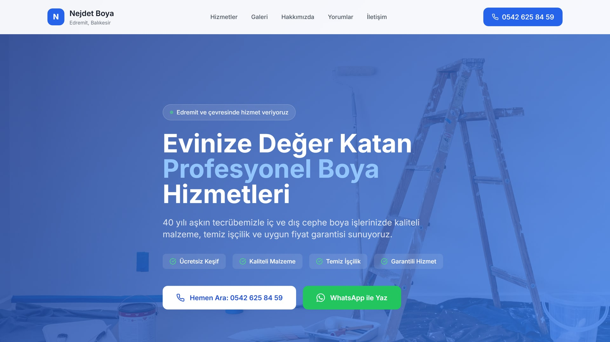

# Nejdet Boya

Template one-page website for a local tradesman, shown here for a house painter in Edremit, Türkiye. It is a sample project: the photos are stock images and the customer comments are placeholder text. The goal was calls, not a brochure: the phone and WhatsApp buttons come first, then the services, a photo gallery and a free survey request over WhatsApp. The site is in Turkish.

**Live demo:** [nejdet.demo.commitius.com](https://nejdet.demo.commitius.com)



## Stack

- [Next.js 14](https://nextjs.org) (App Router, static export)
- React 18 and TypeScript
- Tailwind CSS 3
- Lucide icons
- Hosted on Cloudflare Pages

## What is in it

- Click-to-call and WhatsApp buttons that stay in reach on small phones.
- Sections for services, gallery, about, customer comments and contact. A survey request opens WhatsApp with a ready message.
- All business details and content in one typed file, `src/config/site.ts`, so a change does not mean touching components.
- Local SEO basics: Turkish title and description with the town name, Open Graph tags.
- A cookie notice that only stores the visitor's choice. No analytics or tracking scripts are loaded.
- Fully static output: no server, no database, no API keys.

## Project structure

```
src/
  app/
    layout.tsx        metadata, fonts
    page.tsx          section order
    globals.css
  components/
    Header.tsx, Footer.tsx, WhatsAppButton.tsx, CookieBanner.tsx
    sections/         Hero, Services, Gallery, About, Testimonials, Contact
  config/
    site.ts           business info, services, gallery, comments
public/images/        gallery photos
```

## Run locally

Requires Node.js 18 or newer.

```bash
npm install
npm run dev
```

Open http://localhost:3000.

## Build

```bash
npm run build
```

The static site is written to `out/`. To publish on Cloudflare Pages:

```bash
npx wrangler pages deploy out --project-name nejdet-boya
```

## Editing content

Open `src/config/site.ts`. To add a gallery photo, put the file in `public/images/` and add an entry to `galleryImages`:

```ts
{ id: 6, src: "/images/new-photo.jpg", alt: "Exterior wall after painting", category: "dış-cephe" }
```

## Credits

Gallery and hero photos are from [Pexels](https://www.pexels.com) under the Pexels license. Design and build by [commitius](https://commitius.com).
